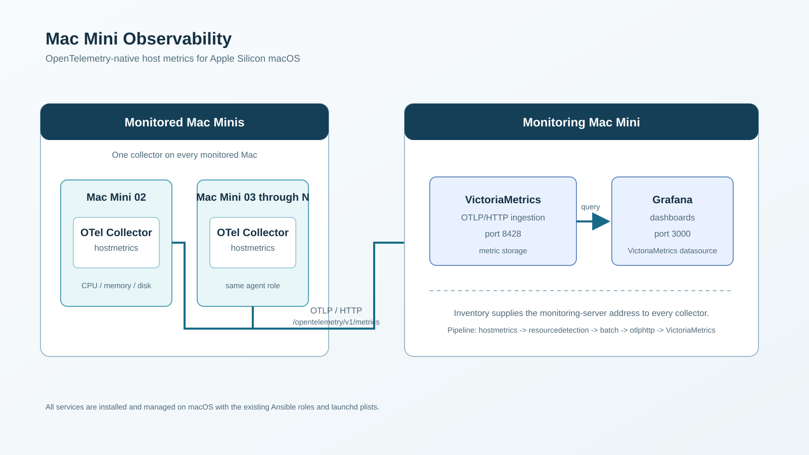

# Mac Mini Fleet Observability

[](LICENSE)


Ansible automation that deploys a complete, self-hosted observability stack to a fleet of Apple Silicon Mac Minis, **without sudo or administrator rights**. Every Mac reports host metrics, network latency and SSH access state; Macs that serve models with **MLX-LM** or **MLX-VLM** can also report inference, quality and capacity telemetry. One Mac stores everything in **VictoriaMetrics** and serves **11 Grafana dashboards** and **28 alert rules**, including SLO burn-rate alerts.

> **This is the LaunchAgent / no-sudo variant** (`LaunchAgent` branch). Everything installs under the deployment user's home (`~/tools/observability`) and runs as **per-user LaunchAgents** (`~/Library/LaunchAgents`, launchd domain `user/<uid>`). Per-user agents **do not start at boot**, and the SSH session data an unprivileged collector can see is partial. The system-level variant (root LaunchDaemons) is `main`. Read [docs/LAUNCHAGENT_VARIANT.md](docs/LAUNCHAGENT_VARIANT.md) before relying on this for unattended monitoring.

## Contents

- [Highlights](#highlights)
- [Architecture](#architecture)
- [Dashboards](#dashboards)
- [Alerting and SLOs](#alerting-and-slos)
- [Quick start](#quick-start)
- [Configuration](#configuration)
- [Operations](#operations)
- [Security](#security)
- [Versions](#versions)
- [Testing](#testing)
- [Validation status](#validation-status)
- [Troubleshooting](#troubleshooting)
- [Documentation](#documentation)

## Highlights

| Area | What you get |
| --- | --- |
| **Fleet health** | CPU, memory, disk, filesystem, network and load from every Mac (OpenTelemetry `hostmetrics`), TCP latency to the monitoring Mac, SSH Remote Login state and live SSH sessions. |
| **LLM serving** (optional) | A transparent OpenAI-compatible proxy in front of `mlx_lm.server` / `mlx_vlm.server`: requests, streaming TTFT, generation time, tokens/s, errors, finish reasons (truncation), response kinds (chat, reasoning, tool call), **tool calls per function name**, prompt-cache reuse, server health, and framework auto-detection. |
| **Model and capacity** | Architecture from the model's `config.json` (layers, KV heads, head dim, quantisation), weights size, estimated KV-cache bytes per token and at full context, and how many more tokens / full-context sequences fit in each Mac's free memory. |
| **KV cache** | One metric family across three sources: MLX-LM's prompt cache (read from its log), MLX-VLM's prefix cache and OMLX. |
| **Answer confidence** (opt-in) | Mean and weakest token probability, perplexity and low-confidence responses, computed from the sampled tokens' logprobs. |
| **SRE** | Availability and latency SLIs, error budgets, multi-window burn rates and burn-rate alerts; fleet alerts for silent Macs, CPU, memory, disk, latency, SSH and collector data loss. |
| **Watching the watchers** | Collector delivery (points sent, failed, queue fill, CPU, memory) from every Mac and VictoriaMetrics' own ingestion, storage and free disk. |
| **Operations** | No sudo; idempotent re-runs (`changed=0`); checksum-pinned downloads; versioned installs behind symlinks for rollback; preflight guards; side-by-side mode next to a system-level stack. |
| **Privacy** | No prompts, completions, images, request ids or user ids in metrics, labels or logs. Labels are bounded and sanitised (model and tool names capped). |

There is deliberately **no Prometheus server and no node_exporter**: collectors push OTLP to VictoriaMetrics.

## Architecture



```
every Mac (otelcol-contrib, LaunchAgent)                         monitoring Mac (LaunchAgents)
  hostmetrics ─┐
  tcp_check ───┤                                                  ┌──────────────────────────┐
  SSH state ───┼─▶ resourcedetection ─▶ batch ─▶ otlphttp ──────▶ │ VictoriaMetrics :8428    │
  self-metrics ┤        (host.name)                               │  (+ its own metrics)     │
  otlp/llm ────┘   ▲                                              └────────────┬─────────────┘
                   │ OTLP, loopback                                            │
  MLX telemetry agent (optional) ◀── clients                       ┌───────────▼─────────────┐
     proxy :18080 ─▶ mlx_lm.server / mlx_vlm.server :8080          │ Grafana :3000           │
     health · hardware · model config · KV cache · confidence      │ 11 dashboards, 28 rules │
                                                                   └─────────────────────────┘
```

| Role | Target | LaunchAgents | Installs |
| --- | --- | --- | --- |
| `observability_server` | `monitoring_server` (exactly one Mac) | `…victoriametrics`, `…grafana` | VictoriaMetrics, Grafana, datasource, dashboards (3 folders), alert rules |
| `observability_agent` | `monitored_nodes` (any number) | `…otelcol`, `…sshstate` | `otelcol-contrib`, host-metric + latency + SSH + self-monitoring pipeline |
| `observability_llm` | `monitored_nodes` with `llm_observability_enabled: true` | `…mlxtelemetry` | MLX telemetry agent (Python standard library only) |
| `observability_common` | included by the others | – | preflight guards, directory layout, versioned installs, launchd helpers, the shared plist template |

Labels are `com.observability.user.<service>`. Each role runs `preflight` → install/configure → `flush_handlers` → `verify`. Details: [docs/PROJECT_FLOW.md](docs/PROJECT_FLOW.md).

## Dashboards

Provisioned from templates into three Grafana folders. Every dashboard carries a **Dashboards** menu linking all the others, shares the crosshair between panels, and says *why* a panel is empty ("No streaming requests", "Confidence disabled") instead of showing a fake zero. **Observability Home** replaces Grafana's welcome page.

| Folder | Dashboard | Answers |
| --- | --- | --- |
| Platform | **Observability Home** | Is anything wrong right now? Fleet status, LLM status, firing alerts, every dashboard. |
| Platform | **Observability Stack Health** | Is the monitoring itself working? Signal freshness per Mac, collector delivery, VictoriaMetrics ingestion and disk. |
| Platform | **Alerts Overview** | Which rules fire or are pending, and the state of every rule by folder. |
| Fleet | **Mac Mini Fleet Overview** | All Macs: CPU, memory, disk, network, load, latency, SSH. |
| Fleet | **Mac Mini Detail** | One Mac in depth, including live SSH sessions. |
| LLM | **LLM Cluster Overview** | Fleet view of inference: traffic, latency, errors, hardware, health, frameworks. |
| LLM | **LLM Node Detail** | One LLM node: health, hardware, performance, troubleshooting. |
| LLM | **LLM Performance, KV Cache and Quality** | Latency distributions, context, KV cache, quality heuristics, framework comparison. |
| LLM | **LLM Service Levels (SLO)** | Availability and latency SLIs, error budgets, burn rates, per-node SLIs. |
| LLM | **LLM Traffic, Tools and Outcomes** | Request mix, finish reasons and truncation, tool calls per function, status codes, tokens. |
| LLM | **LLM Model, Capacity and Confidence** | Architecture, weights and KV sizing vs memory, context use, KV cache, token confidence. |

Full panel-by-panel catalogue: [docs/DASHBOARDS.md](docs/DASHBOARDS.md).

## Alerting and SLOs

| Group | Rules | Examples |
| --- | --- | --- |
| Fleet (always) | 11 | Mac stopped reporting, CPU / memory / disk high, root volume almost full, latency high, monitoring Mac unreachable, SSH not answering, collector dropping metrics, export queue filling, VictoriaMetrics disk low |
| LLM (with LLM observability) | 17 | Server down, process missing, error rate, TTFT / generation / request p95, restarts, memory or thermal pressure, stale telemetry, and **4 SLO burn-rate rules** (availability and TTFT, fast and slow burn) |

Default objectives: **99.5 %** availability and **95 %** of streaming requests with TTFT ≤ **2 s** (non-streaming ≤ 30 s), over a rolling **30 days**. Burn-rate alerts follow the Google SRE workbook (14.4x over 1 h and 5 m pages, 6x over 6 h and 30 m tickets). All thresholds are role variables. No notification channel is provisioned; add a contact point in Grafana. Rule-by-rule runbooks: [docs/ALERTING.md](docs/ALERTING.md).

## Quick start

### Prerequisites

- A control machine with the full **`ansible`** package (not bare `ansible-core`: `ansible.cfg` uses the `yaml` callback from `community.general`).
- Apple Silicon Macs with Remote Login (SSH) enabled for the deployment user. **No sudo or admin rights are needed on any Mac.**
- One monitoring Mac and at least one other Mac to monitor.
- Network access from the monitored Macs to the monitoring Mac on `victoriametrics_port` (8428, or 8429 side by side), and browser access to Grafana on `grafana_port` (3000, or 3001).

### 1. Inventory

Edit [inventories/production/hosts.yml](inventories/production/hosts.yml): exactly one host in `monitoring_server`, every other Mac in `monitored_nodes`. Never commit real addresses or credentials.

```yaml
all:
  children:
    monitoring_server:
      hosts:
        monitoring-mac:
          ansible_host: <monitoring-mac-address>
          ansible_user: <ssh-user>
    monitored_nodes:
      hosts:
        mac-mini-02:
          ansible_host: <mac-address>
          ansible_user: <ssh-user>
          # Optional: this Mac serves a model with mlx_lm.server / mlx_vlm.server
          llm_observability_enabled: true
          mlx_server_port: 8080
```

```bash
ansible all -i inventories/production/hosts.yml -m ping
```

### 2. Deploy

```bash
ansible-playbook -i inventories/production/hosts.yml site.yml        # everything
```

Staged rollout:

```bash
ansible-playbook -i inventories/production/hosts.yml site.yml --tags server                       # monitoring Mac
ansible-playbook -i inventories/production/hosts.yml site.yml --tags agent --limit mac-mini-02    # one Mac
ansible-playbook -i inventories/production/hosts.yml site.yml --tags agent                        # the rest
ansible-playbook -i inventories/production/hosts.yml site.yml --tags verify                       # checks only
```

There is no `--ask-become-pass`; `--become` makes preflight fail on purpose. Behind a proxy, pass `-e '{"proxy_env":{"https_proxy":"http://proxy:port"}}'`.

### 3. Open Grafana

Browse to `http://<monitoring-mac>:3000` (or `:3001`), sign in as `admin` with `grafana_admin_password`, and start from **Observability Home**. LLM clients must call the telemetry proxy (`http://127.0.0.1:18080/v1`) instead of the server's own port to be measured; see [docs/LLM_OBSERVABILITY.md](docs/LLM_OBSERVABILITY.md#how-applications-must-connect).

## Configuration

Role defaults live in `roles/<role>/defaults/main.yml`; the cross-role contract (ports, monitoring address, auth, side-by-side mode) in `inventories/production/group_vars/all.yml`. The most-used switches:

| Variable | Default | Effect |
| --- | --- | --- |
| `llm_observability_enabled` | `false` | Per Mac: install the MLX telemetry agent. |
| `llm_confidence_metrics_enabled` / `llm_confidence_inject_logprobs` | `false` / `false` | Token-confidence metrics; ask MLX-LM for logprobs on non-streaming requests (stripped from replies). |
| `mlx_server_log_path` | `""` | MLX-LM's log file, to report its prompt (KV) cache. |
| `llm_quality_metrics_enabled` | `false` | Text heuristics (repetition, hedging, refusal). |
| `otel_latency_check_enabled` / `otel_ssh_monitoring_enabled` / `otel_self_monitoring_enabled` | `true` | Latency check, SSH state, collector self-metrics. |
| `victoriametrics_self_scrape_interval` | `30s` | VictoriaMetrics' own metrics (empty disables). |
| `victoriametrics_retention` | `90d` | Metric retention. |
| `llm_slo_availability_target` / `llm_slo_latency_target` / `llm_slo_ttft_seconds` / `llm_slo_window` | `99.5` / `95` / `2` / `30d` | Service level objectives. |
| `fleet_alert_cpu_percent` / `_memory_percent` / `_disk_percent` / `_latency_ms` | `90` / `90` / `90` / `200` | Fleet alert thresholds. |
| `observability_side_by_side` | `false` | Run on 8429/3001 next to a system-level stack. |
| `launchd_domain_type` | `user` | `gui` loads the agents in the console session (with auto-login, they start at login). |

## Operations

```bash
launchctl print user/$(id -u)/com.observability.user.otelcol          # status
launchctl kickstart -k user/$(id -u)/com.observability.user.otelcol   # restart
tail -f ~/tools/observability/var/log/otelcol.err.log                 # logs
```

- **After a reboot**, per-user LaunchAgents are not started: re-run the play for that Mac (`--limit <mac> --tags agent`), or use `launchd_domain_type: gui` with auto-login. The *Mac stopped reporting* alert flags it.
- **Upgrades** are a version bump plus checksum in role defaults; releases install side by side and a symlink flip switches them, so rollback is reverting the variable. Old versions are not pruned.
- **Side by side** with the system-level stack: `-e observability_side_by_side=true` moves this stack to 8429/3001 and never touches the old one; without it, preflight refuses to run where the old stack exists.
- **Disabling** LLM observability (`llm_observability_enabled: false`) removes the agent, its collector receiver, the LLM dashboards and rules on the next run.

More commands and a diagnosis table: [docs/LAUNCHAGENT_VARIANT.md](docs/LAUNCHAGENT_VARIANT.md#operating-the-launchagents).

## Security

- Nothing runs as root; no task uses `become`, and preflight fails on uid 0.
- **Defaults are for testing:** `victoriametrics_auth_enabled: false` (anyone who can reach port 8428 can read, write and delete metrics) and `grafana_admin_password: admin`. For real use, set both with Ansible Vault:

  ```bash
  ansible-vault encrypt_string 'a-strong-password' --name 'vault_grafana_admin_password'
  ansible-vault encrypt_string 'a-strong-password' --name 'vault_victoriametrics_password'
  ```

  then `grafana_admin_password: "{{ vault_grafana_admin_password }}"`, `victoriametrics_auth_enabled: true`, `victoriametrics_auth_password: "{{ vault_victoriametrics_password }}"`, and deploy with `--ask-vault-pass`.
- Credential-bearing files are `0600` and their tasks `no_log`; the VictoriaMetrics password reaches launchd as `file://…`, never on the command line.
- The LLM proxy forwards client `Authorization` headers without storing or logging them, keeps no access log, and listens on loopback by default.
- **macOS Local Network Privacy** can block the collector LaunchAgent from reaching a monitoring Mac on the same subnet (`connect: no route to host`). The fix needs the console user or an administrator; see [docs/LAUNCHAGENT_VARIANT.md](docs/LAUNCHAGENT_VARIANT.md#local-network-privacy-why-a-worker-can-get-no-route-to-host).

Reporting a vulnerability: [SECURITY.md](SECURITY.md).

## Versions

| Component | Version | Why it matters |
| --- | --- | --- |
| OpenTelemetry Collector Contrib | `0.159.0` | **Minimum usable on macOS**: in `0.98.0` the `cpu` and `disk` scrapers emit nothing on darwin. |
| VictoriaMetrics | `1.101.0` | Runs with `-opentelemetry.usePrometheusNaming`; without it every dashboard is empty. |
| Grafana | `13.2.0` | Grafana 11+ has no `grafana-server`; the plist runs `grafana server`. |
| MLX telemetry agent | `1.3.0` | Python 3.9+ standard library (macOS `/usr/bin/python3`); tested against mlx-lm 0.31.3 and 0.32.2, mlx-vlm 0.7.11. |

Every download is SHA-256 pinned, so a version bump needs the matching `*_checksum`.

## Testing

```bash
ansible-playbook site.yml --syntax-check
ansible-lint                                                      # production profile, must pass
python3 -m unittest discover -s tests -v                          # telemetry agent unit and contract tests
ansible-playbook tests/render_templates.yml -e render_dir=/tmp/render \
  && python3 tests/check_dashboards.py /tmp/render                # render + lint every dashboard and rule file
python3 tests/check_panel_queries.py http://<monitoring-mac>:3000 <host>   # every panel query against live data
```

CI runs all but the last on every pull request. Because nothing needs sudo, the whole playbook also runs against your own Mac with `ansible_connection: local`; see [CONTRIBUTING.md](CONTRIBUTING.md#testing-on-a-mac).

## Validation status

**Verified on one Apple Silicon Mac (macOS 27, uid 501, no sudo, `ansible_connection: local`)** with the pinned binaries and a real `mlx_lm.server` (0.31.3, Qwen3-4B-Instruct-2507-4bit) for release 1.3.0 of the agent:

| Check | Result |
| --- | --- |
| Full `site.yml`, both plays, then a second run | `failed=0`, then `changed=0` on both plays. |
| Dashboards | 11 dashboards in 3 folders; 444 panel queries through Grafana's datasource proxy, **0 errors**. Under traffic, every panel of Home, LLM Service Levels and LLM Traffic returned data. The empty ones elsewhere were for things that did not happen or that MLX-LM does not report: request errors, MLX-VLM, SSH sessions, and KV capacity, SSD tier and hit ratio (MLX-LM reports only cache size and sequences). |
| Alert rules | 28 rules loaded, all health `ok`. |
| Telemetry agent | 18 unit and contract tests; with real MLX-LM, the reply stripped of injected logprobs was byte-identical to MLX-LM's own reply; streamed and non-streamed tool calls, finish reasons, model architecture, weights size and MLX-LM prompt-cache figures reached VictoriaMetrics under the documented names. |
| Disable / re-enable LLM on the server | LLM dashboards and rules removed (11 fleet rules kept), then restored. |

Earlier rounds (host metrics, SSH sessions, side-by-side mode, guards, domain switching, MLX-VLM, OMLX stub) are recorded in [docs/LAUNCHAGENT_VARIANT.md](docs/LAUNCHAGENT_VARIANT.md) and [docs/LLM_OBSERVABILITY.md](docs/LLM_OBSERVABILITY.md#validation).

**Not yet tested on physical Mac Minis:** deployment over real SSH; agents surviving the end of the SSH session, logout/login and reboot; SSH state against a real `com.openssh.sshd` with live sessions; side-by-side mode against a real system-level stack; 20+ hosts; alert notification delivery; a real OMLX server. On the first real side-by-side run (MM7 server, MM4 worker) the worker's collector could not export, consistent with Local Network Privacy. Do not treat this branch as production-tested until a monitoring Mac and one worker succeed over SSH and survive a reboot cycle.

## Troubleshooting

| Problem | First checks |
| --- | --- |
| Ansible cannot connect | `ansible_host`, `ansible_user`, SSH keys, `ansible all -m ping`. |
| Preflight fails | The message names the cause: root/become, missing launchd domain, old system-level stack present, or a port in use. |
| A Mac is missing from Grafana | *Observability Stack Health* → *Last report per Mac*; then `launchctl print user/$(id -u)/com.observability.user.otelcol` and the collector log on that Mac. After a reboot, re-run its play. |
| `connect: no route to host` in the collector log | Local Network Privacy; see [Security](#security). |
| LLM request panels empty, health panels fine | Clients call the server directly; point them at the proxy port. |
| A panel says why it is empty | Usually a disabled feature or nothing happened yet ("Confidence disabled", "No tool calls"). |
| Port conflict | `lsof -nP -iTCP:<port> -sTCP:LISTEN`; use side-by-side mode if it is the old stack. |

## Documentation

| Document | Contents |
| --- | --- |
| [docs/DASHBOARDS.md](docs/DASHBOARDS.md) | Every dashboard and panel, variables, conventions |
| [docs/ALERTING.md](docs/ALERTING.md) | Every alert rule with a runbook, SLO definitions, notifications |
| [docs/LLM_OBSERVABILITY.md](docs/LLM_OBSERVABILITY.md) | MLX telemetry agent: proxy, metrics, variables, KV cache, confidence, limits, validation |
| [docs/LAUNCHAGENT_VARIANT.md](docs/LAUNCHAGENT_VARIANT.md) | This variant vs `main`, LaunchAgent lifecycle, SSH capability matrix, side-by-side mode |
| [docs/PROJECT_FLOW.md](docs/PROJECT_FLOW.md) | Internal flow with diagrams |
| [docs/KT_GUIDE.md](docs/KT_GUIDE.md) | Onboarding walkthrough and FAQ |
| [docs/RESOURCE_FOOTPRINT.md](docs/RESOURCE_FOOTPRINT.md) | Measured disk use |
| [docs/CONFLUENCE_LAUNCHAGENT_GUIDE.html](docs/CONFLUENCE_LAUNCHAGENT_GUIDE.html) | Paste-ready Confluence guide |
| [CHANGELOG.md](CHANGELOG.md) · [CONTRIBUTING.md](CONTRIBUTING.md) · [SECURITY.md](SECURITY.md) | Release notes, how to contribute, security policy |

## Acknowledgements

Several signals and dashboard ideas in release 1.3.0 (finish reasons and call kinds, per-tool call tracking, token confidence from logprobs, model-architecture and KV sizing panels, MLX-LM prompt-cache figures from its log, SLO and error-budget views, an alerts overview) were inspired by [hellodk/mlx-oc](https://github.com/hellodk/mlx-oc) (MIT). They were reimplemented here for this project's push-based, no-sudo design; mlx-oc's Opik tracing, Docker/podman stack, sudo-based power metrics and ring-interconnect panels were not adopted.

## License

Released under the [MIT License](LICENSE).
