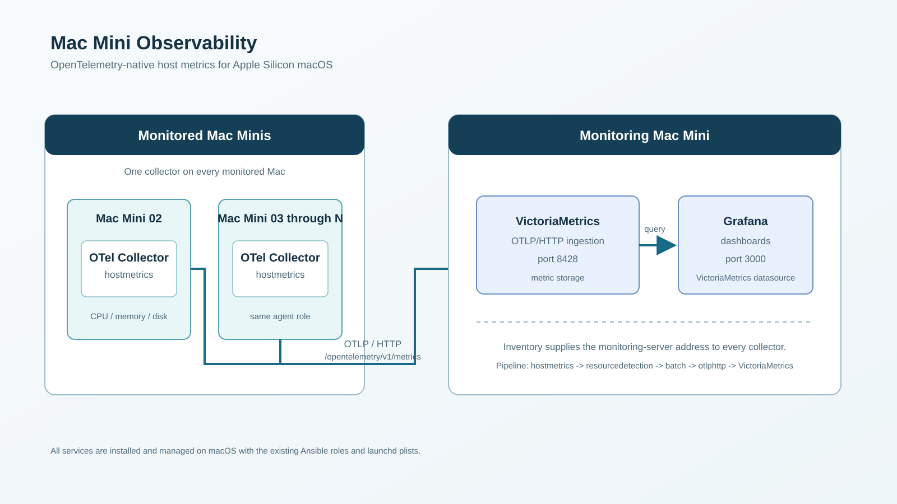

# Mac Mini Observability: LaunchAgent / no-sudo variant

Ansible automation for host-metric observability on Apple Silicon Mac Minis. One monitoring Mac Mini runs VictoriaMetrics and Grafana; every monitored Mac Mini runs an OpenTelemetry Collector.

> **This branch is the LaunchAgent / no-sudo variant of `main`.** It deploys the same stack with **no sudo and no administrator rights**. Everything installs under the deployment user's home (`~/tools/observability`) and runs as **per-user LaunchAgents** (`~/Library/LaunchAgents`, launchd domain `user/<uid>`), not as root LaunchDaemons. Ansible still connects over normal SSH. Per-user agents **do not start at boot**, and the SSH session data an unprivileged collector can see is partial. Read [docs/LAUNCHAGENT_VARIANT.md](docs/LAUNCHAGENT_VARIANT.md) before relying on this for unattended monitoring.

## Architecture



The metric path is unchanged from `main`:

`hostmetrics + tcp_check + SSH state -> resourcedetection -> batch -> otlphttp -> VictoriaMetrics -> Grafana`

- `hostmetrics` collects CPU, memory, disk, filesystem, network and load.
- `tcp_check` measures TCP connect latency from each Mac to VictoriaMetrics on the monitoring Mac.
- SSH state is collected by a per-user LaunchAgent, `com.observability.user.sshstate`, every 30 s, and read through the collector's `otlp_json_file` receiver. It records whether Remote Login is on, whether port 22 is listening, whether sshd answers, and each SSH session it can attribute (user, source address, terminal, login time), plus the count of established SSH connections. Nothing from inside a session is recorded.
- Grafana provisions two dashboards: **Mac Mini Fleet Overview** (all hosts, with a multi-select **Mac Mini** selector) and **Mac Mini Detail** (one reusable per-host dashboard, opened by clicking a host on the fleet dashboard).

Each collector sends OTLP/HTTP to `http://<monitoring-server-address>:<victoriametrics_port>/opentelemetry/v1/metrics`. There is no Prometheus server and no node_exporter.

| Role | Target | Runs as LaunchAgents |
| --- | --- | --- |
| `observability_server` | `monitoring_server` (exactly one Mac) | `com.observability.user.victoriametrics`, `com.observability.user.grafana` |
| `observability_agent` | `monitored_nodes` (any number, 20+ fine) | `com.observability.user.otelcol`, `com.observability.user.sshstate` |

### Differences from `main`

| | `main` | This branch |
| --- | --- | --- |
| Privilege | sudo (`--ask-become-pass`) | none: `become = False`, preflight fails on root |
| Services | root LaunchDaemons, `/Library/LaunchDaemons`, `system` domain | per-user LaunchAgents, `~/Library/LaunchAgents`, `user/<uid>` domain |
| Install root | `/opt/observability` (`root:wheel`) | `~/tools/observability` (deployment user) |
| Starts at boot | yes | no: re-run the play after a reboot, or use `launchd_domain_type: gui` with auto-login |
| SSH sessions | all sessions (root `lsof`) | sessions attributable without root, plus a new `ssh_connections` total; see the [capability matrix](docs/LAUNCHAGENT_VARIANT.md#ssh-observability-capability-matrix) |
| Side-by-side with the system stack | n/a | opt-in `observability_side_by_side` (8429 / 3001) |

## Before deployment

You need:

- A control machine with the full `ansible` package (not bare `ansible-core`: `ansible.cfg` uses the `yaml` callback from `community.general`).
- Apple Silicon Macs running macOS with Remote Login (SSH) enabled for the deployment user. **No sudo or admin rights are required on any Mac.**
- One Mac selected as the monitoring server and at least one separate Mac selected as a monitored node.
- The reachable address, SSH user and SSH authentication method for each Mac.
- Network access from monitored Macs to the monitoring Mac on `victoriametrics_port` (`8428`, or `8429` in side-by-side mode), and browser access to Grafana on `grafana_port` (`3000`, or `3001`).

Use SSH keys where possible. Confirm connectivity:

```bash
ansible all -i inventories/production/hosts.yml -m ping
```

## Prepare the inventory

Edit [inventories/production/hosts.yml](inventories/production/hosts.yml). Define exactly one host in `monitoring_server` and put each collector host in `monitored_nodes`.

```yaml
all:
  children:
    monitoring_server:
      hosts:
        monitoring-mac:
          ansible_host: <monitoring-mac-address>
          ansible_user: <ssh-user>
    monitored_nodes:
      hosts:
        agent-mac-01:
          ansible_host: <agent-mac-address>
          ansible_user: <ssh-user>
```

The agents derive `monitoring_server_address` from the monitoring-server inventory entry. Do not put real addresses or credentials in source-controlled files.

## Deploy (no sudo)

The whole fleet, both plays:

```bash
ansible-playbook -i inventories/production/hosts.yml site.yml
```

There is no `--ask-become-pass` and no `-b` on this branch; passing `--become` makes preflight fail on purpose.

Staged, one of each first:

```bash
# 1. Monitoring Mac
ansible-playbook -i inventories/production/hosts.yml site.yml --tags server

# 2. One worker
ansible-playbook -i inventories/production/hosts.yml site.yml --tags agent --limit agent-mac-01

# 3. The rest of the fleet
ansible-playbook -i inventories/production/hosts.yml site.yml --tags agent

# Verification tasks only
ansible-playbook -i inventories/production/hosts.yml site.yml --tags verify
```

Each role runs `preflight` → install/configure → `flush_handlers` → `verify`. Verification checks that the LaunchAgents are running in the per-user domain, that VictoriaMetrics and Grafana are healthy, the datasource and both dashboards are provisioned (server), and that the collector config validates and this Mac's metrics reach VictoriaMetrics (agent).

If a Mac can reach GitHub only through a proxy, pass `proxy_env`:

```bash
ansible-playbook -i inventories/production/hosts.yml site.yml --tags server \
  -e '{"proxy_env":{"http_proxy":"http://127.0.0.1:9000","https_proxy":"http://127.0.0.1:9000"}}'
```

### After deployment

1. On the monitoring Mac: `curl http://localhost:8428/health` (or `:8429`). Logs are in `~/tools/observability/var/log/victoriametrics.err.log`.
2. Open `http://<monitoring-mac-address>:3000` (or `:3001`), sign in as `admin` with `grafana_admin_password`, and open **Mac Mini Fleet Overview**.
3. On a worker: `~/tools/observability/bin/otelcol-contrib validate --config=$HOME/tools/observability/etc/otel-config.yaml` and `~/tools/observability/var/log/otelcol.err.log`.

### After a reboot

Per-user LaunchAgents are not started at boot. Re-run the play for that Mac:

```bash
ansible-playbook -i inventories/production/hosts.yml site.yml --limit mac-mini-02 --tags agent
```

Or set `launchd_domain_type: gui` and enable auto-login for the deployment user so launchd starts the agents at login. The full lifecycle (login, logout, reboot, and what is unverified) is in [docs/LAUNCHAGENT_VARIANT.md](docs/LAUNCHAGENT_VARIANT.md#launchagent-lifecycle).

## Side-by-side testing with the old system-level stack

If the system-level deployment from `main` is still running on some Macs and you cannot remove it, run this stack beside it on alternate ports:

```bash
ansible-playbook -i inventories/production/hosts.yml site.yml -e observability_side_by_side=true
```

or set `observability_side_by_side: true` in `inventories/production/group_vars/all.yml`. VictoriaMetrics then listens on `8429`, Grafana on `3001`, and every collector exports to `8429`. Config and data live under `~/tools/observability`, and labels are `com.observability.user.*`. The old stack (`/opt/observability`, `/Library/LaunchDaemons`, `8428`/`3000`) is never stopped, unloaded or modified.

Without the flag, preflight **fails** on any Mac where it finds the old LaunchDaemons, rather than run two copies on the same ports. Turn the flag off for a normal deployment once the old stack is gone, and re-run both plays. Details are in [docs/LAUNCHAGENT_VARIANT.md](docs/LAUNCHAGENT_VARIANT.md#side-by-side-testing-with-the-system-level-deployment).

## Managing the services

As the deployment user, no sudo:

```bash
launchctl print user/$(id -u)/com.observability.user.otelcol         # status
launchctl kickstart -k user/$(id -u)/com.observability.user.otelcol  # restart
launchctl bootout user/$(id -u)/com.observability.user.otelcol       # stop/unload
launchctl bootstrap user/$(id -u) ~/Library/LaunchAgents/com.observability.user.otelcol.plist  # start/load
```

Re-running the play always restores the intended state. More commands and a diagnosis table: [docs/LAUNCHAGENT_VARIANT.md](docs/LAUNCHAGENT_VARIANT.md#operating-the-launchagents).

## Secrets

No vault is required by default: `victoriametrics_auth_enabled: false` in `inventories/production/group_vars/all.yml`, and `grafana_admin_password` in `inventories/production/group_vars/monitoring_server.yml` is a plain, checked-in default (`admin`). This is meant for local/testing use: anyone who can reach the VictoriaMetrics port can read, write or delete fleet metrics, and Grafana logs in with the default credentials.

For anything beyond that, set real credentials, plain or vaulted:

```bash
ansible-vault encrypt_string 'replace-with-a-strong-password' --name 'vault_grafana_admin_password'
ansible-vault encrypt_string 'replace-with-a-strong-password' --name 'vault_victoriametrics_password'
```

Set `grafana_admin_password: "{{ vault_grafana_admin_password }}"` and, to require auth on VictoriaMetrics, `victoriametrics_auth_enabled: true` plus `victoriametrics_auth_password: "{{ vault_victoriametrics_password }}"`. The collectors, the Grafana datasource and VictoriaMetrics are all rendered from the same credentials, so deploy all three from the same source, adding `--ask-vault-pass`. Credential-bearing files stay `0600` and their tasks are `no_log`. The VictoriaMetrics password is passed as `file://...`, never as an argument.

## Versions and macOS compatibility

| Component | Version | Why this version matters |
| --- | --- | --- |
| OpenTelemetry Collector Contrib | `0.159.0` | **Minimum usable version on macOS.** In `0.98.0` the `hostmetrics` `cpu` and `disk` scrapers return `not implemented yet` on darwin. |
| VictoriaMetrics | `1.101.0` | Runs with `-opentelemetry.usePrometheusNaming`; without it every dashboard query returns nothing. |
| Grafana | `13.2.0` | Grafana 11+ removed `grafana-server`; the plist runs `grafana server`. |

Versions, checksums and tuning are role defaults under `roles/<role>/defaults/main.yml`. Every download is checksum-verified, so a version bump also needs the matching `*_checksum`. Each release installs into a versioned directory behind a stable symlink (`~/tools/observability/bin/otelcol-contrib`, `.../victoria-metrics-prod`, `~/tools/observability/grafana`), so upgrades are a symlink flip and old versions stay on disk for rollback.

## Troubleshooting

| Problem | First checks |
| --- | --- |
| Ansible cannot connect | `ansible_host`, `ansible_user`, SSH keys, `ansible all -m ping`. |
| Preflight fails | Read the message. It names the cause: root/become, missing launchd domain, old system-level stack present, or a port in use. See [diagnosing failures](docs/LAUNCHAGENT_VARIANT.md#diagnosing-failures). |
| An agent is not running | `launchctl print user/$(id -u)/<label>`, then `~/tools/observability/var/log/<service>.err.log`. |
| Metrics do not appear | Collector log; from the worker, `curl http://<monitoring-mac>:<port>/health`; check side-by-side mode is set the same for server and workers. |
| Worker missing after reboot | Expected; re-run the play for that host. |
| Port conflict | `lsof -nP -iTCP:<port> -sTCP:LISTEN`; use side-by-side mode if it is the old stack. |

## Validation

**Static checks on this branch, all passing:** `ansible-playbook site.yml --syntax-check`, `ansible-inventory --list` and `ansible-lint` (production profile, 0 findings). The rendered dashboards are valid JSON, all four rendered plists pass `plutil -lint`, the rendered collector config passes `otelcol-contrib validate` (inside the verify tasks), and the rendered SSH script passes `sh -n`.

**Run on one Apple Silicon Mac (macOS 27.0.1), as uid 501 with no sudo, over `ansible_connection: local`.** The inventory had one host per group, with scratch `base_dir`/`launch_agents_dir`, a test label prefix and spare ports:

| Check | Result |
| --- | --- |
| Full `site.yml`, both plays | `failed=0`. All four LaunchAgents loaded in `user/501` (VictoriaMetrics, Grafana and collector `state = running`; sshstate periodic, exit 0); none in `gui/501`. |
| Second run | `changed=0`, no handlers fired. |
| Ownership and modes | Every installed file is owned by the deployment user; `grafana.ini`, `otel-config.yaml` and the datasource are `0600`, `ssh-state/` is `0700`, nothing is world-writable, and archives are removed after extraction. |
| Dashboards | Datasource uid `victoriametrics` points at the configured port. Every panel query on both dashboards, run through Grafana's datasource proxy, returns data, except **Current SSH Sessions** with Remote Login off (no sessions, as expected). |
| SSH sessions end to end | With `otel_ssh_port` pointed at a test port held by a process titled `sshd-session: <user>@notty`, the session reached VictoriaMetrics with the correct `user_name`, `source_address`, `ssh_session_tty` and `ssh_session_id`, and both **Current SSH Sessions** tables returned it. |
| Side-by-side mode | With fake old-stack plists present: VictoriaMetrics listened on 8429, Grafana on 3001, the datasource and collector targeted 8429, and only the services whose config changed restarted. |
| Guards | Old stack present without side-by-side → preflight fails, names the plist. Side-by-side port equal to the old port → fails. Port already in use → fails, names the port, writes nothing. `--become` → ignored by the play's `become: false` (ran unprivileged, `changed=0`). `-e ansible_become=true` → Ansible's own sudo attempt fails at fact gathering, before any task runs. |
| Domain switching | `launchd_domain_type: gui` → agents moved to `gui/501` with `Aqua`, no copy left in `user/501`. A re-run was `changed=0`. Switching back to `user` moved them back. |

**Not yet tested on physical Mac Minis:**

- Deployment over real SSH to remote Macs.
- Whether `user/<uid>` agents survive the end of the SSH session that started them, a console logout/login, and a reboot (expected: not started at boot).
- `launchd_domain_type: gui` with auto-login across a reboot.
- SSH state against a real `com.openssh.sshd` with Remote Login on and sessions from several users. Enabling Remote Login needs an admin, so the session path was tested with a stand-in process, not real sshd.
- Side-by-side mode against a real running system-level deployment (it was simulated with placeholder plists).
- Network/firewall policy between Macs, and 20+ hosts at once.

**Found on the first real side-by-side deployment (MM7 server, MM4 worker), October 2026:**

- **Collector port conflict (fixed).** The collector's internal telemetry defaulted to `127.0.0.1:8888`, which the system-level collector already holds, so the new collector could not start. It now uses `otel_internal_metrics_port` (18888), and preflight checks that port. Reproduced and fixed locally, with a stand-in listener on 8888.
- **The new collector can't send to the monitoring Mac when both are on the same subnet.** With both Macs on one subnet, the collector LaunchAgent on MM4 logged `connect: no route to host` to `10.43.110.29:8429`. Over SSH, `curl` to the same address returned 200, and the root system-level collector kept working. That pattern matches macOS Local Network Privacy, which exempts root, launchd daemons and SSH sessions but not launchd agents. This is a diagnosis, not yet confirmed on MM4. It needs the console user or an administrator; see [Local Network Privacy](docs/LAUNCHAGENT_VARIANT.md#local-network-privacy-why-a-worker-can-get-no-route-to-host). Agent verification now names it when it happens.

Do not treat this branch as production-tested until a monitoring Mac plus one worker Mac succeed over SSH and survive a reboot cycle as documented.

## More documentation

- [LaunchAgent / no-sudo variant](docs/LAUNCHAGENT_VARIANT.md): differences, lifecycle, SSH capability matrix, side-by-side mode, operations
- [Project internal flow](docs/PROJECT_FLOW.md)
- [KT guide](docs/KT_GUIDE.md)
- [Resource footprint](docs/RESOURCE_FOOTPRINT.md)
- [Contributing guide](CONTRIBUTING.md)

## License

Released under the [MIT License](LICENSE).
