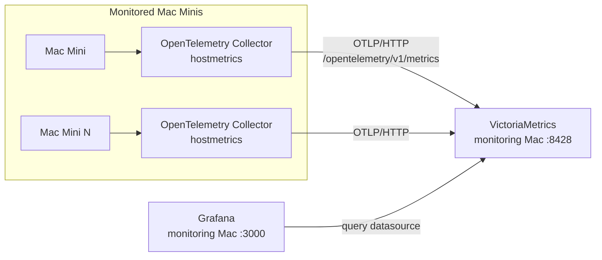
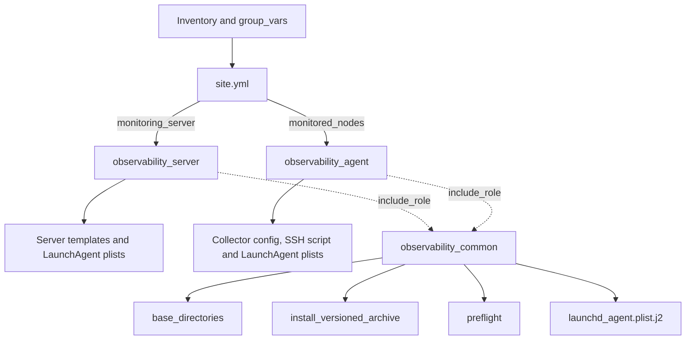

# Project Flow

## Overview

> This is the **LaunchAgent / no-sudo** branch. Everything below runs as the connecting SSH user, installs under `~/tools/observability`, and is managed as per-user LaunchAgents in `user/<uid>`. See [LAUNCHAGENT_VARIANT.md](LAUNCHAGENT_VARIANT.md) for how this differs from the system-level `main` branch.

This project automates host-metric observability for Apple Silicon Mac Minis. It has two applied Ansible roles: `observability_server` configures one monitoring Mac Mini, and `observability_agent` configures every monitored Mac Mini. The same agent role is reused as the fleet grows.

A third role, `observability_common`, is a library rather than something applied to hosts. It holds the parts both roles would otherwise duplicate three times over: the read-only preflight guards, the user-owned `~/tools/observability` directory layout, the download → checksum → versioned-extract → verify install flow, and one LaunchAgent plist template shared by all four services. Both roles pull these in with `ansible.builtin.include_role` and `tasks_from`.

The shared install flow deliberately stops before creating the stable symlink and before notifying any restart handler. The symlink flip is the moment a service's running version actually changes, so it stays in the calling role beside the handler it triggers.

## Overall architecture



The collector is deliberately the host-metric agent. It collects data on a Mac, adds resource identity, batches data, and delivers it directly to VictoriaMetrics with OTLP/HTTP. Grafana reads the stored data through its provisioned VictoriaMetrics datasource.

## Inventory and playbook flow

`inventories/production/hosts.yml` defines two groups:

- `monitoring_server`: exactly one central Mac Mini.
- `monitored_nodes`: every Mac Mini that should send host metrics.

Variables are split by ownership:

- `roles/<role>/defaults/main.yml` holds versions, checksums, install paths, ports and tuning. Each role is self-contained and can be run against a different inventory.
- `group_vars/all.yml` holds only the **cross-role contract** - `victoriametrics_port`, `monitoring_server_address`, and the VictoriaMetrics authentication settings. These must agree between the monitoring Mac and every agent, so they are defined exactly once.
- `group_vars/<group>.yml` holds credentials (plain by default, or vault references) and per-environment overrides.

`monitoring_server_address` is derived from the first host in `monitoring_server`; this is how agents receive the destination address without a hard-coded server address. The agent role asserts that this group contains exactly one host with `ansible_host` set, so a misconfigured inventory fails with a clear message instead of an index error.



`site.yml` has one play for each inventory group. Tags allow the server play (`--tags server`) and agent play (`--tags agent`) to be run independently.

## Monitoring Mac flow

The `observability_server` role imports tasks in this order:

1. `prerequisites.yml` runs `preflight` (unprivileged user, per-user launchd domain present, no clash with a system-level deployment, ports free), then creates the user-owned `~/tools/observability` directories for binaries, configuration, data, plugins, downloads and logs.
2. `victoriametrics.yml` writes the `0600` basic-auth password file, downloads and checksum-verifies the archive, extracts it into a versioned directory, repoints the `victoria-metrics-prod` symlink, renders its LaunchAgent plist, and bootstraps it into the per-user domain if not loaded.
3. `grafana.yml` extracts Grafana into a versioned directory, repoints the `~/tools/observability/grafana` symlink, renders `grafana.ini`, provisions the VictoriaMetrics datasource and the fleet and detail dashboards, renders its LaunchAgent plist, and bootstraps it if not loaded.
4. `flush_handlers` applies any pending restarts **before** verification, so the checks below see the configuration this run just produced rather than the previous one.
5. `verify.yml` checks that both LaunchAgents report `state = running` in the per-user domain, VictoriaMetrics health, that its query API accepts the configured credentials and rejects unauthenticated access, Grafana health, the Grafana datasource API, and that the fleet and detail dashboards were provisioned.

The VictoriaMetrics plist (`~/Library/LaunchAgents/com.observability.user.victoriametrics.plist`) points to `~/tools/observability/bin/victoria-metrics-prod`, stores data in `~/tools/observability/var/victoriametrics`, logs under `~/tools/observability/var/log`, and listens on the shared port variable (default `8428`, `8429` in side-by-side mode). All plist paths are absolute. Grafana's plist runs `~/tools/observability/grafana/bin/grafana server` (Grafana 11+ removed the separate `grafana-server` binary); its configuration, data, plugin, and log paths agree with the rendered `grafana.ini`.

## Monitored Mac flow

The `observability_agent` role imports tasks in this order:

1. `prerequisites.yml` asserts the `monitoring_server` group is usable, runs `preflight`, then creates the shared directory structure.
2. `opentelemetry.yml` downloads and checksum-verifies the Darwin ARM64 `otelcol-contrib` archive, extracts it into a versioned directory, asserts the binary exists, repoints the `~/tools/observability/bin/otelcol-contrib` symlink, renders the `0600` collector configuration and the LaunchAgent plist, and bootstraps it if not loaded. (`ssh_state.yml` runs before it and installs the SSH state script and its periodic LaunchAgent.)
3. `flush_handlers` applies the pending restart before verification.
4. `verify.yml` checks the collector LaunchAgent is running (and the SSH state agent is loaded), reachability to the monitoring server, runs `otelcol-contrib validate` against the rendered configuration, and then waits for host metrics to actually appear in VictoriaMetrics before reporting the hosts currently reporting.

The collector plist starts the same binary and configuration that the role renders:

```text
/Users/<user>/tools/observability/bin/otelcol-contrib
--config=/Users/<user>/tools/observability/etc/otel-config.yaml
```

## Collector pipeline

The generated collector configuration has one metrics pipeline:

```text
hostmetrics + tcp_check + otlp_json_file/ssh_state -> resourcedetection -> batch -> otlphttp -> VictoriaMetrics
```

`tcp_check/monitoring_server` times a TCP connect to `<monitoring_server_address>:<victoriametrics_port>` every collection interval, producing `tcpcheck_duration_milliseconds` (latency to the monitoring Mac) and `tcpcheck_status_ratio` (1 reachable, 0 failed). It is controlled by `otel_latency_check_enabled` in the agent role defaults.

`com.observability.user.sshstate` (a per-user LaunchAgent with `StartInterval`, running as the deployment user) runs `bin/observability-ssh-state` every `otel_ssh_check_interval` (30 s). The script writes a one-line OTLP/JSON snapshot to `var/ssh-state/ssh-state.json` (`0700` directory, `0600` file), and the collector's `otlp_json_file/ssh_state` receiver reads each snapshot exactly once. That works because the snapshot's timestamp sits inside the receiver's 1000-byte file fingerprint. The metrics are `ssh_remote_login_enabled`, `ssh_port_listening`, `ssh_service_up`, `ssh_sessions`, `ssh_connections` and `ssh_session_start_time_seconds`. Without root, sessions are attributed through `netstat -anv` socket owners and utmpx rather than `lsof`; see the capability matrix in [LAUNCHAGENT_VARIANT.md](LAUNCHAGENT_VARIANT.md#ssh-observability-capability-matrix) and the SSH section of CLAUDE.md.

| Stage | What it does | Why it is used |
| --- | --- | --- |
| `hostmetrics` | Scrapes CPU, memory, disk, filesystem, network, and load data from macOS. | Provides host telemetry without an additional host agent. |
| `resourcedetection` | Detects system resource attributes, including the OS hostname. | Associates metrics with the Mac that emitted them. |
| `batch` | Groups telemetry before export. | Reduces individual export operations. |
| `otlphttp` | Sends metric payloads over OTLP/HTTP. | Uses VictoriaMetrics' OpenTelemetry ingestion endpoint. |
| `basicauth` | Attaches basic-auth credentials to the export. | VictoriaMetrics rejects unauthenticated writes when `victoriametrics_auth_enabled` is true. |

VictoriaMetrics runs with `-opentelemetry.usePrometheusNaming`. Without that flag it stores OTLP metric names verbatim, dots included (`system.memory.usage`, label `host.name`), and every dashboard query returns nothing.

The exporter endpoint is rendered from variables as:

```text
http://<monitoring_server_address>:<victoriametrics_port>/opentelemetry/v1/metrics
```

VictoriaMetrics persists the metric data. Grafana has two provisioned dashboards:

- **Mac Mini Fleet Overview** (`mac-mini-fleet`): every host on shared panels, one series per `host_name`, plus a Hosts table. A multi-value **Mac Mini** variable (`label_values(system_memory_usage_bytes, host_name)`, All = `.*`) filters every panel with `host_name=~"$host_name"`.
- **Mac Mini Detail** (`mac-mini-detail`): one reusable per-host dashboard driven by a single-value `host_name` variable. Clicking a series in a fleet time-series panel, or a host name in the Hosts table, opens it with `?var-host_name=<host>` and the current time range.

Both dashboards have SSH panels. The fleet dashboard has an **SSH Access** table (Remote Login, SSH Service UP/DOWN, port, attributed session count and TCP connection count per host) and a **Current SSH Sessions** table. The detail dashboard has an **SSH / Access** row with the same signals for one host, plus a session and TCP-connection history.

## Variables into templates

Ansible loads inventory and group variables for the target host, then renders Jinja2 templates with those values. For example:

1. The agent obtains `monitoring_server_address` from `group_vars/all.yml`.
2. It also obtains `victoriametrics_port` from the shared variables.
3. `otel-config.yaml.j2` inserts both into the OTLP/HTTP metric endpoint.
4. `launchd_agent.plist.j2` inserts `bin_dir`, `etc_dir`, and `log_dir` (all absolute, under the user's home) into `ProgramArguments` and log paths.

The same pattern connects server variables to the VictoriaMetrics and Grafana plists and configuration templates. This centralizes environment values and prevents the roles from embedding real infrastructure addresses.

## launchd integration

The roles render per-user LaunchAgent plists in `~/Library/LaunchAgents` for:

- `com.observability.user.victoriametrics`
- `com.observability.user.grafana`
- `com.observability.user.otelcol`
- `com.observability.user.sshstate` (periodic, `StartInterval` instead of `KeepAlive`)

`ansible.builtin.service` has no macOS implementation, so the tasks and handlers drive `launchctl` directly in the per-user domain (`user/<uid>`, or `gui/<uid>`): bootstrap-if-not-loaded to start, bootout+bootstrap on restart. Nothing is bootstrapped into `system/`. Per-user agents are not started at boot; see the lifecycle table in [LAUNCHAGENT_VARIANT.md](LAUNCHAGENT_VARIANT.md#launchagent-lifecycle). For diagnostics and manual recovery, see [operating the LaunchAgents](LAUNCHAGENT_VARIANT.md#operating-the-launchagents).

## First Mac test flow

1. Put one monitoring Mac and one agent Mac in their respective inventory groups.
2. Deploy the server play and confirm VictoriaMetrics health and Grafana access.
3. Deploy the agent play and validate the collector configuration.
4. Confirm the agent can reach `victoriametrics_port` (`8428`, or `8429` side by side) on the monitoring Mac.
5. Confirm metrics arrive and appear in Grafana.
6. Re-run the same plays to assess idempotency and observe launchd behavior.
7. Reboot the worker and re-run the agent play for it (LaunchAgents do not start at boot).

This is the required validation point before scaling. The full playbook has been run unprivileged on one Mac over a local connection; it has not yet been run over SSH against Mac Minis.

## Scaling flow

After the first test works, add more hosts under `monitored_nodes` and run the agent play against that group. To stage a deployment or investigate one Mac, use `--limit <inventory-alias>`. No new role or pipeline is required for additional nodes; inventory membership determines where the existing agent role runs.

## Failure and troubleshooting flow

Start at the layer nearest the failure:

1. **Ansible access:** verify inventory address, SSH user, key access, and `ansible all -m ping`. No sudo is involved.
2. **Preflight:** its failure message names the cause (root/become, missing launchd domain, system-level stack present, port in use).
3. **Installation paths:** verify binaries and generated configuration under `~/tools/observability`.
4. **Service process:** `launchctl print user/$(id -u)/<label>` and the stdout/stderr logs under `~/tools/observability/var/log`.
5. **Network:** verify agent access to the monitoring Mac on `victoriametrics_port`; check server port conflicts.
6. **Data:** check VictoriaMetrics health, then the Grafana datasource and dashboard.

Use [diagnosing failures](LAUNCHAGENT_VARIANT.md#diagnosing-failures) for plist validation, `launchctl` commands, logs, and common service failures.

## Automated and manual responsibilities

| Automated by Ansible | Requires operator or real-Mac validation |
| --- | --- |
| Directory creation, downloads, archive extraction, template rendering, dashboard/datasource provisioning, and service requests | Inventory values, SSH access, Vault secret handling, network/firewall policy, LaunchAgent behaviour across logout and reboot, and confirmation of end-to-end metrics |

Before physical Macs are available, static checks can validate YAML, Jinja templates, XML, JSON, variable references, and Ansible syntax when installed. Runtime behavior requires the first physical monitoring-and-agent test.
